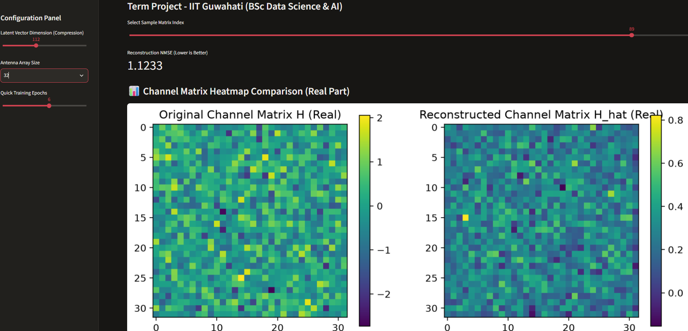

# AI-Powered CSI Feedback Compression System for 5G/6G Massive MIMO

An advanced Streamlit-based web application designed to compress Channel State Information (CSI) feedback in massive MIMO wireless communication systems using deep learning (PyTorch). Developed as a term project (IIT Guwahati - BSc Data Science & AI).

## 🚀 Features
- **Deep Learning Architecture:** Custom PyTorch neural network modules for efficient feature extraction and reconstruction.
- **Interactive Web Interface:** Built with Streamlit for real-time visualization and parameter tuning.
- **Performance Evaluation:** Visualizes compression metrics and reconstruction accuracy.

## 📊 Heatmap Visualization


## 🛠️ Tech Stack
- **Python** (Core logic & data generation)
- **PyTorch** (Neural network models)
- **Streamlit** (Web application UI)
- **Matplotlib & NumPy** (Data processing & plotting)

## ⚙️ Installation & Running Locally

1. Clone the repository:
   ```bash
   git clone [https://github.com/YOUR_USERNAME/csi_mimo_project.git](https://github.com/YOUR_USERNAME/csi_mimo_project.git)
   cd csi_mimo_project
